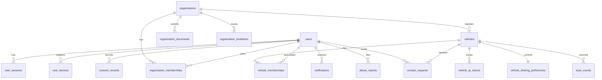

# Entity-relationship diagram

## Key relationships and rules

- `organization_memberships(orgId, userId)` unique — one membership record per user per org; carries `role` + `status`. Roles are NEVER taken from the client or the JWT.
- `vehicles`: partial unique index `(orgId, registrationNumber) WHERE status IN ('ACTIVE','PENDING_APPROVAL')` — one live record per reg number per org; history preserved (REJECTED/DEACTIVATED rows remain).
- `vehicle_memberships(vehicleId, userId)` unique — owner vs authorized-user via `associationType`; association requires target to be an org member.
- `vehicle_qr_tokens.tokenHash` unique — sha256 of the opaque token; exactly one ACTIVE token per vehicle (rotation revokes predecessors in one transaction).
- `vehicle_sharing_preferences` 1:1 with vehicle — enforced server-side at QR resolve; no QR re-issue needed when changed.
- `contact_requests.idempotencyKey` unique (namespaced `userId:key`) — safe retries.
- `otp_challenges` — HMAC of code only; status machine PENDING→VERIFIED/EXPIRED/LOCKED; resend cooldown timestamp.
- `user_sessions.refreshTokenHash` unique — rotation revokes old session each refresh.
- `audit_logs` — append-only; actor/org/action/resource + minimal metadata; never stores secrets or raw PII payloads.

## Retention

| Data | Policy |
|---|---|
| sessions | Expire by TTL; revoked rows purgeable after 90d |
| otp_challenges | Purge > 7d (job) |
| scan_events | Aggregate after 90d; purge raw rows |
| notifications | Purge > 180d |
| audit_logs | Retain ≥ 1 year (compliance), archive after |
| deleted users | PII anonymized in place; audit rows retain opaque user id |
| documents | S3 versioning + 90d noncurrent expiry; legal hold overrides |
